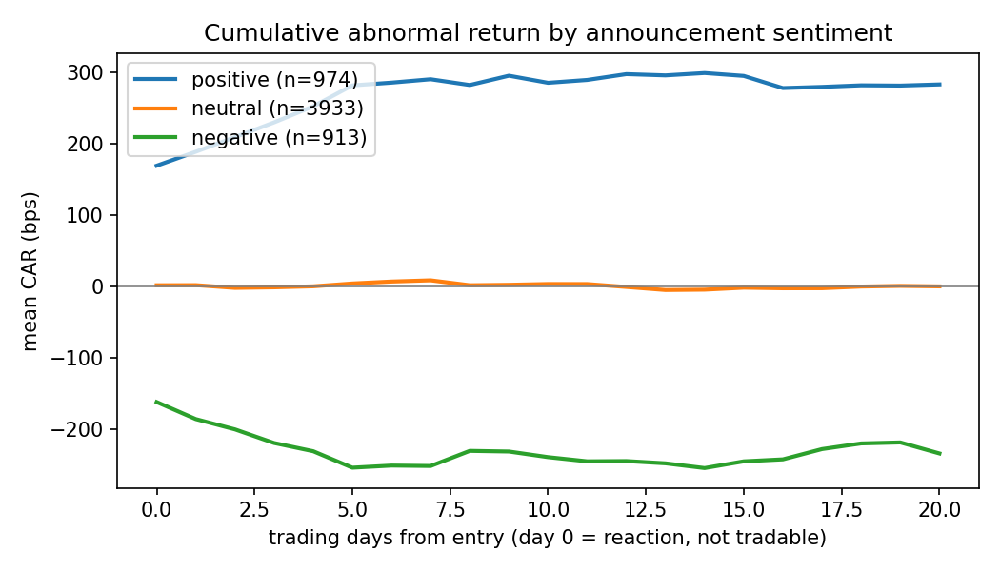
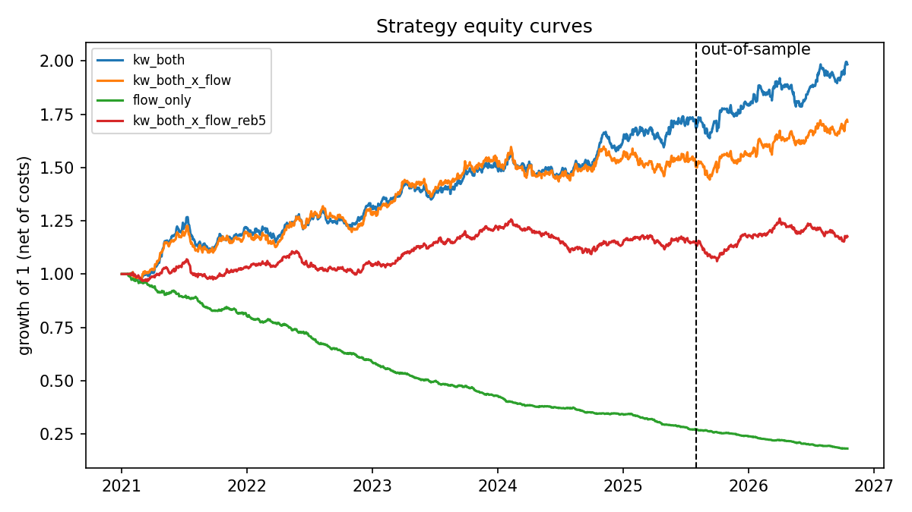
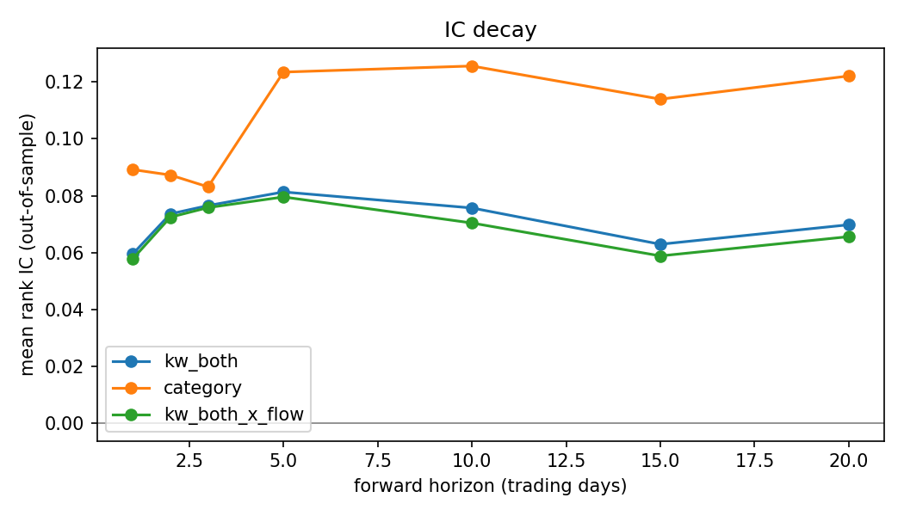

# HK Announcement Alpha

[](https://github.com/AndrewLukmantara/hk-announcement-alpha/actions/workflows/tests.yml)


**Do Hong Kong Stock Exchange announcements predict returns *after* the market has reacted, and is the effect stronger when mainland investors are buying through Stock Connect?**

This repository is an end-to-end research pipeline that answers that question. It scrapes every HKEXnews filing in English and Traditional Chinese, scores each one with an LLM, aligns it to the first close you could actually trade at, and measures the result with an event study and an out-of-sample backtest net of Hong Kong trading costs.

---

## Contents

- [Results](#results)
- [How it works](#how-it-works)
- [Quick start](#quick-start)
- [How to backtest](#how-to-backtest)
- [Running on real HKEX data](#running-on-real-hkex-data)
- [Methodology](#methodology)
- [Limitations](#limitations)
- [Repository layout](#repository-layout)

---

## Results

> **These results come from the synthetic validation market, not from real HKEX data.**
> The synthetic market has a known planted effect: a 3% reaction plus a 2% five-day drift that grows with Southbound buying. These numbers show that the pipeline recovers that effect correctly. They say nothing about real Hong Kong stocks. Live results will replace this section once the data collection finishes.

**Sample:** January 2021 to October 2026, with August 2025 onward held out as out-of-sample. That split falls after the LLM scorer's training-data cutoff. 7,125 announcement–stock events across 80 stocks. The primary signal is the bilingual keyword score.

### 1. Announcements move prices, and the move keeps going



Day 0 is the reaction from the prior close to the first tradable close, which you cannot capture. Everything after day 0 is drift a strategy can trade.

| Sentiment | Events | Reaction, day 0 (bps) | Drift, days 1–5 (bps) | t-stat (1–5) |
|---|---:|---:|---:|---:|
| Positive | 974 | +169 | +113 | 7.1 |
| Neutral | 3,933 | +2 | +2 | 0.3 |
| Negative | 913 | −162 | −92 | −5.7 |

### 2. Southbound flow amplifies the drift

This is a regression of 5-day drift on sentiment, its interactions with Southbound flow and short interest, and liquidity. Standard errors are clustered by announcement date.

| Term | Coefficient | z |
|---|---:|---:|
| Sentiment | 0.0142 | 9.1 |
| Sentiment × Southbound flow | 0.0105 | 6.6 |
| Sentiment × short interest | 0.0038 | 2.4 |

The planted Southbound interaction is recovered with a z-statistic of 6.6. The short-interest term was not planted, so its z of 2.4 is a reminder to correct for multiple tests on real data. In the live run, this is the core test of the project.

### 3. The backtest: alpha exists, but costs eat most of it



| Signal | OOS IC (5d) | OOS Sharpe, gross | OOS Sharpe, net | Daily turnover |
|---|---:|---:|---:|---:|
| Keyword, English + Chinese | 0.081 | 2.86 | 1.41 | 29% |
| Keyword, English only | 0.083 | 2.98 | 1.60 | 28% |
| Keyword, Chinese only | 0.075 | 2.50 | 1.26 | 27% |
| Keyword × Southbound flow | 0.080 | 2.94 | 1.12 | 38% |
| Keyword × flow, weekly rebalance | 0.047 | 1.15 | 0.28 | 12% |
| Southbound flow only (no news) | −0.003 | −0.70 | −5.84 | 60% |

Each round trip costs about 38 bps, including 10 bps of stamp duty on each side. That cost cuts a gross Sharpe near 2.9 to about 1.4 net. Controlling turnover is the main lever on real data. Flow on its own, without news, has no edge.



---

## How it works

```
HKEXnews (EN + ZH) ──► scorers: LLM · keyword · category ──► tradable entry date
CCASS Southbound   ──┐                                              │
Short selling      ──┼──► lagged features ──────────► event study + interaction regression
Prices (yfinance)  ──┘                                              │
                                        decayed daily signal ──► walk-forward backtest ──► reports/
```

1. **Collect.** The pipeline pulls HKEXnews filings in both languages, Southbound shareholdings from CCASS, daily short-selling turnover, and prices.
2. **Score.** Claude scores each filing with the issuer name and stock code removed. The prompt asks for event type, sentiment, and surprise. Two baselines run alongside it: a bilingual keyword lexicon of real HKEX filing phrases, and a score from the HKEX category label alone.
3. **Align.** Each filing is mapped to the first 16:00 close at least 30 minutes after publication. A filing after the close trades the next day. A filing at lunch or before the open trades the same day.
4. **Measure.** A market-model event study separates the reaction from the drift. A regression tests whether Southbound flow and short interest change the size of the drift.
5. **Backtest.** Sentiment decays exponentially into a daily score. The half-life is chosen on in-sample data only. The long/short portfolio is tested out-of-sample after all HK costs.

---

## Quick start

No internet is needed. This runs on the synthetic market.

```bash
git clone https://github.com/AndrewLukmantara/hk-announcement-alpha.git
cd hk-announcement-alpha
pip install -e ".[live,dev]"

pytest -q                                # 15 tests
hkalpha run --synthetic --regenerate     # full pipeline -> reports/synthetic/summary.md
```

---

## How to backtest

### Option A: the full pipeline

```bash
hkalpha run --synthetic      # synthetic market
hkalpha run                  # real data (after the fetch steps below)
```

This produces the event study, regressions, every signal variant, and the backtests. Output goes to `reports/<synthetic|live>/`:

| File | Contents |
|---|---|
| `summary.md` | Every table: timing, event study, regressions, ablation |
| `ablation.csv` | In-sample and out-of-sample IC, Sharpe, drawdown, and turnover per signal |
| `event_study_by_type.csv` | Reaction and drift by event type |
| `car_paths.png`, `equity.png`, `ic_decay.png` | Figures |

### Option B: change the settings

Everything is controlled by `config.yaml`. These are the settings that matter most:

| Setting | Default | Effect |
|---|---|---|
| `dates.oos_start` | `2025-08-01` | Start of the out-of-sample period, set after the LLM's training-data cutoff. |
| `nlp.llm_model` | `claude-haiku-4-5` | Scoring model. Its training data ends July 2025, which leaves about 14 months of clean out-of-sample data. |
| `signal.primary` | `kw_both` | Main signal. Switch to `llm_both` once LLM scores exist. |
| `signal.half_lives` | `[2, 5, 10, 20]` | Candidate decay half-lives. The best one is chosen on in-sample IC. |
| `signal.flow_tilt` | `0.5` | How strongly Southbound flow scales the news signal. |
| `backtest.mode` | `long_short` | Use `long_only` if your names aren't on the HKEX shortable list. |
| `backtest.quantile` | `0.3` | Fraction of scored names held long and short. |
| `backtest.rebalance_every_slow` | `5` | Rebalance period, in days, for the low-turnover variant. |
| `backtest.costs.*` | HK schedule | Stamp duty, levies, commission, slippage, and borrow cost. |
| `market.entry_lag_minutes` | `30` | Minimum gap between publication and the close you trade at. |
| `universe.min_adv_hkd` | `20,000,000` | Liquidity filter on 20-day average turnover. |

### Option C: write your own signal in Python

`examples/custom_backtest.py` runs a complete custom strategy. This example trades only earnings and placing events with a 5-day half-life, tilts by Southbound flow, and rebalances weekly:

```python
events  = scores[scores["event_type"].isin(["earnings_positive", "earnings_negative", "placing"])]
signal  = decayed(event_matrix(events, "kw_both", dates, stocks), half_life=5)
signal  = flow_tilt(signal, southbound_flow_z(d["southbound"], dates, stocks), k=0.5)
weights = rebalance_every(build_weights(signal, eligible, "long_short", 0.3, 3), 5)
bt      = run_backtest(weights, ret, Costs(**cfg["backtest"]["costs"]))
```

```bash
python examples/custom_backtest.py
```

The backtest rules are as follows. Weights are set at the close of day *t* and earn the return from *t* to *t+1*. Every trade pays the per-side cost. Shorts pay borrow. Returns on suspended days count as zero.

---

## Running on real HKEX data

### Option 1: in the cloud with GitHub Actions (recommended)

Two workflows do all the data work on GitHub's servers and save results to a separate `data` branch. Your laptop doesn't need to stay on.

| Workflow | What it does | How to start |
|---|---|---|
| `collect-daily` | Saves the short-selling report each weekday at 16:45 HKT, and yesterday's Southbound holdings at 09:00 HKT | Runs automatically. Trigger it once by hand with `backfill_days = 360` to save the 12 months of Southbound history before it expires. |
| `fetch-history` | Fetches the announcement history and prices, scores with the LLM if `ANTHROPIC_API_KEY` is set as a repo secret, runs the study, and uploads `reports/live/` | Actions tab → fetch-history → Run workflow. Resumable: if it hits the time limit, run it again. |

To use the data locally, run `scripts/data_branch.sh restore`.

### Option 2: on your machine

```bash
hkalpha fetch-announcements --start 2021-01-01 --end 2025-12-31   # about 1 request/s, resumable
hkalpha fetch-prices                                              # universe from data/universe.csv
hkalpha fetch-southbound --start 2025-01-01 --end 2025-12-31      # HKEX keeps ~12 months
hkalpha fetch-shortselling                                        # today only; schedule it daily

export ANTHROPIC_API_KEY=...        # set nlp.use_llm: true and signal.primary: llm_both
hkalpha score-llm                   # cached in data/cache/, safe to re-run
hkalpha run
scripts/publish_results.sh live     # copy the new figures into docs/figures for this README
```

HKEX only publishes Southbound and short-selling data for a limited window, so collect both daily with cron (HKT):

```
45 16 * * 1-5  cd ~/hk-announcement-alpha && hkalpha fetch-shortselling
0  9  * * 2-6  cd ~/hk-announcement-alpha && hkalpha fetch-southbound --start $(date -d yesterday +\%F) --end $(date -d yesterday +\%F)
```

**Check the scorer before trusting any backtest.** Run `hkalpha label-sample --n 400` and label the CSV it writes by following [`docs/labeling_guide.md`](docs/labeling_guide.md). Then run `hkalpha eval-labels --labels data/raw/label_sample.csv`, which reports each scorer's Spearman correlation and sign accuracy against your labels.

---

## Methodology

| Risk | How it is handled |
|---|---|
| Trading on news before it is public | Entry is the first close at least 30 minutes after publication. A unit test checks that future events never change past scores. |
| Counting the untradable reaction | Day-0 return is reported but never traded. Only drift from day 1 onward counts. |
| Stale or early features | Southbound and short-selling features are lagged one day, matching when HKEX publishes them. |
| LLM remembering outcomes | Issuer names and codes are stripped from prompts. The scorer is Claude Haiku 4.5 (training data to July 2025), and the out-of-sample period starts August 2025, so the model cannot have seen the outcomes it is tested on. |
| Overfitting | Parameters are chosen in-sample only. Every result is reported both in-sample and out-of-sample. |
| Many filings on one night | Regression standard errors are clustered by announcement date. |
| Unrealistic costs | The full HK schedule applies: 10 bps stamp duty per side, exchange, SFC and AFRC levies, commission, slippage, and borrow. |
| Trading halts | Suspended days count as zero abnormal return, so the reaction lands on the resumption day. |

---

## Limitations

- **Survivorship bias.** yfinance omits delisted stocks. Historical Hang Seng Composite constituents would fix this.
- **Shorting restrictions.** Only designated securities can be shorted in Hong Kong, so `long_only` is the strictly implementable version.
- **Short Southbound history.** HKEX's CCASS page only goes back about 12 months, so the flow tests run on a shorter sample than the news signal.
- **Half-day sessions.** Christmas Eve and Lunar New Year's Eve are treated as full trading days.
- **Scraper fragility.** HKEX can change its endpoints. Each scraper's docstring explains how to re-derive the parameters from your browser's network tab.

---

## Repository layout

```
src/hkalpha/
  data/          hkexnews.py · southbound.py · short_selling.py · prices.py · synthetic.py
  nlp/           lexicon.py · keyword.py · llm.py · scoring.py · evaluate.py
  timing.py      HKEX sessions and tradable entry dates
  features.py    price panel, liquidity, Southbound flow and short-interest z-scores
  event_study.py · signal.py · backtest.py · metrics.py · report.py · pipeline.py · cli.py
examples/        custom_backtest.py
scripts/         run_live.sh · data_branch.sh · publish_results.sh
tests/           unit and end-to-end tests
docs/            figures, labelling guide, write-up outline
.github/         tests, daily collection, history fetch
config.yaml      every research setting
```

## License

MIT
